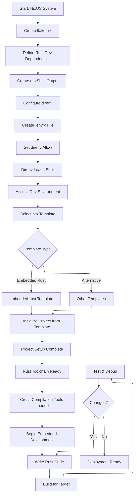
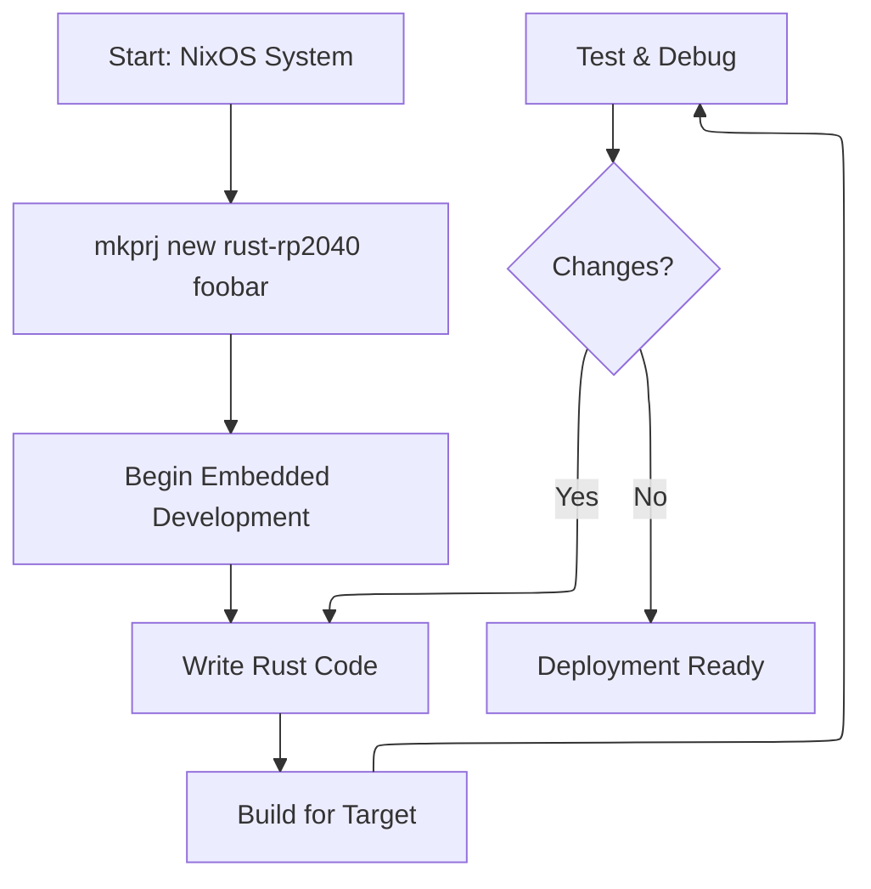

 slaxor/templates

A collection of **Nix flake templates** for Rust, Go, embedded targets, shell tooling, and Typst workflows — designed to be used directly via `nix flake init` or the `mkprj` scaffolding script.

---

## 📦 Available Templates

These templates can be used with:

```bash
nix flake init -t codeberg:slaxor/templates#<template>
Rust
rust-x64
Plain Rust project for native x86_64
rust-esp32c6
Rust environment for ESP32-C6 embedded development
rust-esp32s3
Rust environment for ESP32-S3 embedded development
rust-rp2040
Rust setup for Raspberry Pi Pico (RP2040)
rust-rp2350
Rust setup for Raspberry Pi Pico W (RP2350)
Go
go-cli
Minimal Go CLI project for native development
go-web
Go web service using chi router with logging middleware
Other
shell-tool
Standard Bash-based development environment
typst-doc
Typst document environment for writing and building .typst files
🚀 Recommended Workflow (mkprj)

This repository includes a helper script: mkprj

It wraps nix flake new and adds:

template fetching from Codeberg
project name normalization
git initialization
optional direnv integration
in-place placeholder substitution
🛠️ Install mkprj

Clone this repo and make the script available:

git clone https://codeberg.org/slaxor/templates.git
cd templates
chmod +x mkprj.sh

Optionally symlink it:

ln -s $(pwd)/mkprj.sh ~/.local/bin/mkprj
📁 Usage (mkprj)
Create a new project
mkprj new <template> <path>

Example:

mkprj new rust-x64 my-project
List templates
mkprj list

This queries the flake directly:

nix eval codeberg:slaxor/templates#templates \
  --apply builtins.attrNames --json
Force refresh (important)

Nix caches flake revisions. If you add new templates and they don’t appear:

mkprj list --refresh
mkprj new --refresh rust-x64 my-project
🔧 Template substitution

When creating a project, mkprj:

replaces __PROJECT_NAME__ in files
renames files containing __PROJECT_NAME__
initializes a git repository
creates a .envrc with:
use flake

If direnv is installed, it will automatically run direnv allow .

🧪 Example
mkprj new rust-esp32s3 sensor-node
cd sensor-node
direnv allow
🧱 Direct flake usage (no mkprj)

You can also use templates manually:

nix flake init -t codeberg:slaxor/templates#go-web
nix develop
📂 Repository Structure
.
├── flake.nix
├── mkprj.sh
├── rust-x64/
├── rust-esp32c6/
├── rust-esp32s3/
├── rust-rp2040/
├── rust-rp2350/
├── go-cli/
├── go-web/
├── shell-tool/
└── typst-doc/
📄 License

Add your license here.

🤝 Contributing

Contributions are welcome:

keep templates minimal and reproducible
ensure nix flake check works
avoid unnecessary dependencies
prefer clarity over cleverness in embedded targets
Your workflow (assumed):


or use this

```nix
{ pkgs, ... }:
let
  mkprj = pkgs.writeShellApplication {
    name = "mkprj";
    runtimeInputs = [
      pkgs.nix
      pkgs.git
      pkgs.direnv
      pkgs.jq
    ];
    text = builtins.readFile [./mkprj.sh]; 
  };
in
{
  home.packages = with pkgs; [ mkprj ];
}
```
[mkprj](mkprj.sh)


work like this:)
